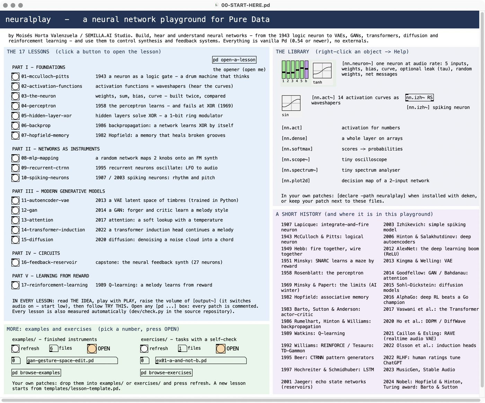

# neural-play

**neuralplay — a neural network playground for Pure Data**
by **Moisés Horta Valenzuela / SEMILLA.AI Studio**

Build, hear and understand neural networks inside Pd — from the 1943 logic neuron to VAEs,
GANs, transformers, diffusion and reinforcement learning — and wire them into circuits that control
synthesis and feedback systems. Seventeen commented lessons, a small library of neuron objects, examples and
self-checking exercises, written for music technology students.
Vanilla **Pd 0.54 or newer**, no externals.



## Quick start

1. Install [Pure Data](https://puredata.info) 0.54 or newer.
2. Clone or download this repository and open **`neuralplay/00-START-HERE.pd`**.
3. Click a lesson. In every lesson raise the `[output~]` volume (it also switches audio on — start low).

## What is inside

| part | lessons |
|------|---------|
| I · Foundations | 01 McCulloch–Pitts · 02 activation functions · 03 the neuron · 04 perceptron · 05 hidden layers (XOR) · 06 backpropagation · 07 Hopfield memory |
| II · Networks as instruments | 08 MLP mapping · 09 recurrent CTRNN oscillators · 10 spiking neurons (LIF, Izhikevich) |
| III · Modern generative models | 11 autoencoder / VAE · 12 GAN · 13 attention · 14 transformer induction head · 15 diffusion |
| IV · Circuits | 16 the neural feedback synth (a 27-neuron reservoir) |
| V · Learning from reward | 17 reinforcement learning: Q-learning, a melody that learns from reward |

Plus examples (a ring-oscillator drone, a spiking drum machine, the GAN gesture space: FM
gestures and granular clouds on your own sound, learned by a GAN whose latent space you walk, and the
applause drummer: reinforcement learning from your claps), exercises with a CHECK
button, and the `nn.*` library (`[nn.neuron~]`, `[nn.act~]`, `[nn.izh~]`, `[nn.dense]`,
`[nn.softmax]`, …). What each lesson teaches and sounds like: [neuralplay/README.md](neuralplay/README.md).

## Repository layout

```
neuralplay/              the Pd package - this folder is what deken ships
  00-START-HERE.pd       start page: lessons, library, history, examples/exercises browser
  nn.*.pd                the library, each with an nn.*-help.pd
  lessons/               the 17 lessons (data/ holds the trained VAE weights)
  examples/              finished instruments - listed on the start page automatically
  exercises/             tasks with a self-check - listed on the start page automatically
  templates/             lesson-template.pd: copy it to start a new patch
  python/train_vae.py    trains the VAE of lesson 11 (numpy only)
  screenshots/           images for the READMEs
dev/                     tests and tools, not part of the package
  check.py               headless test suite: renders every patch and checks the numbers
  shoot.py               screenshots of patches (macOS)
  shadow/, tests/        helpers for check.py
CONTRIBUTING.md          conventions, how to add lessons/examples/exercises/objects/tests, Pd pitfalls
```

## Tests

```sh
python3 dev/check.py                 # every check, about 10 seconds (needs Pd and numpy)
python3 dev/check.py "lesson 04"     # only the checks whose name contains the text
PD=/usr/bin/pd python3 dev/check.py  # Pd somewhere else than the macOS default
```

Pd runs headless and faster than real time; the audio of every lesson is recorded and
compared with independent Python references — the perceptron learns AND/OR/NAND in the same
epochs as a Python perceptron, the CTRNN oscillates at the simulated frequencies, the Pd VAE
matches numpy, the induction head continues melodies exactly like the reference, one GAN training
step in Pd equals the numpy step to float precision, every move of the Q-learning lesson and every
hit and clap of the applause drummer is replayed in numpy. New
examples, exercises and templates are tested automatically.

## Extending it

Start from `neuralplay/templates/lesson-template.pd`. Drop new patches into `examples/` or
`exercises/` and they appear on the start page. [CONTRIBUTING.md](CONTRIBUTING.md) explains
the conventions, how exercises check themselves, how to add a test, and the Pd pitfalls met
while building this.

## Credits and license

© 2026 Moisés Horta Valenzuela / SEMILLA.AI Studio — BSD 3-Clause, see [LICENSE](LICENSE).
Lesson 16 rebuilds the author's *NeuralNetwork-VAE-Dense* patch.
