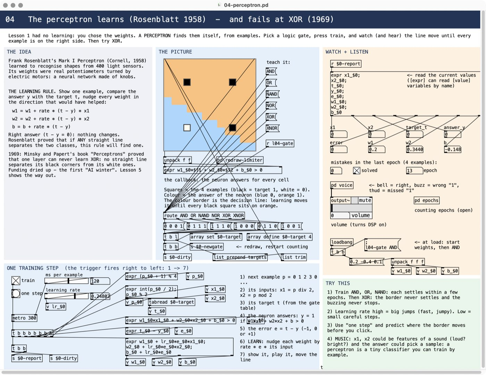
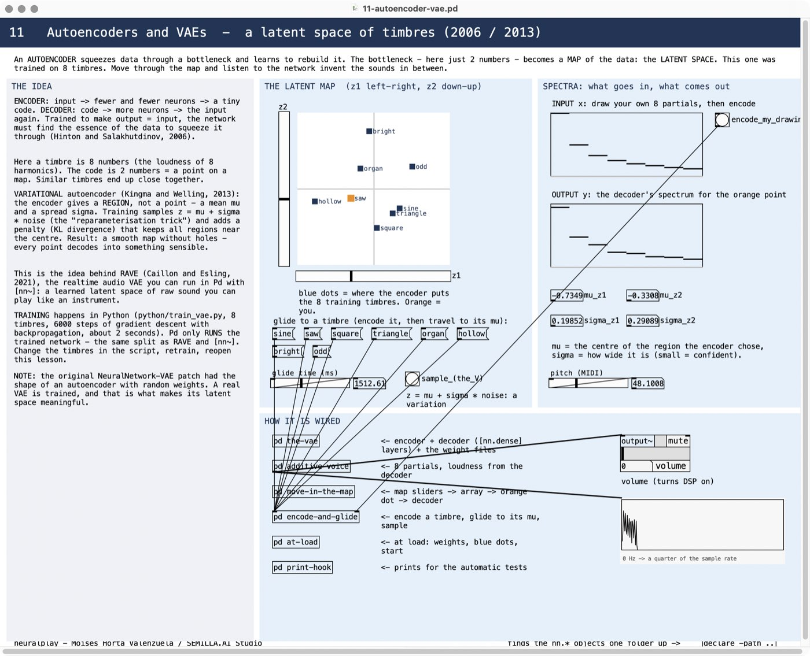
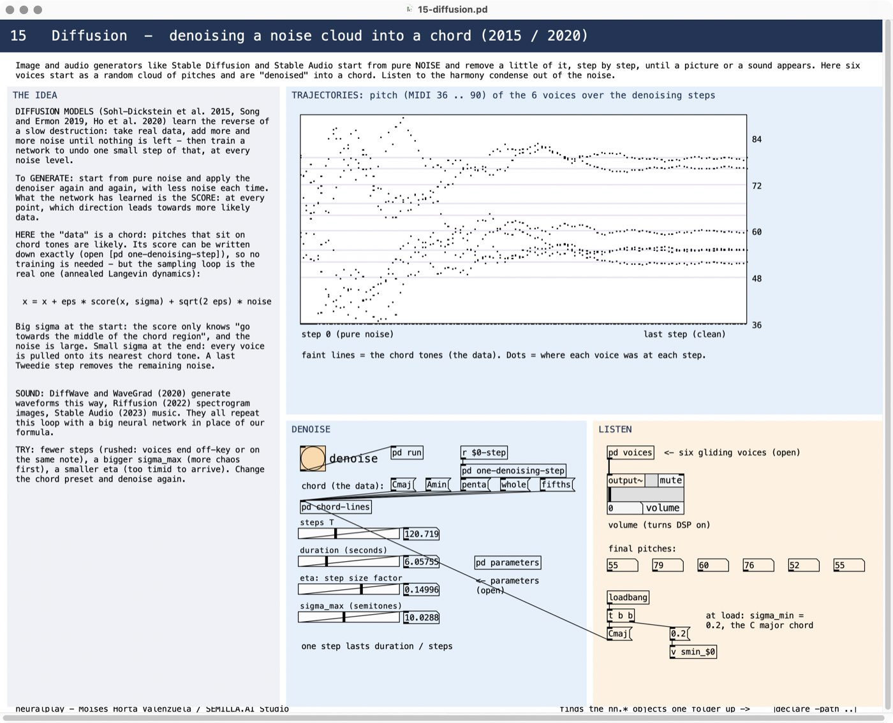
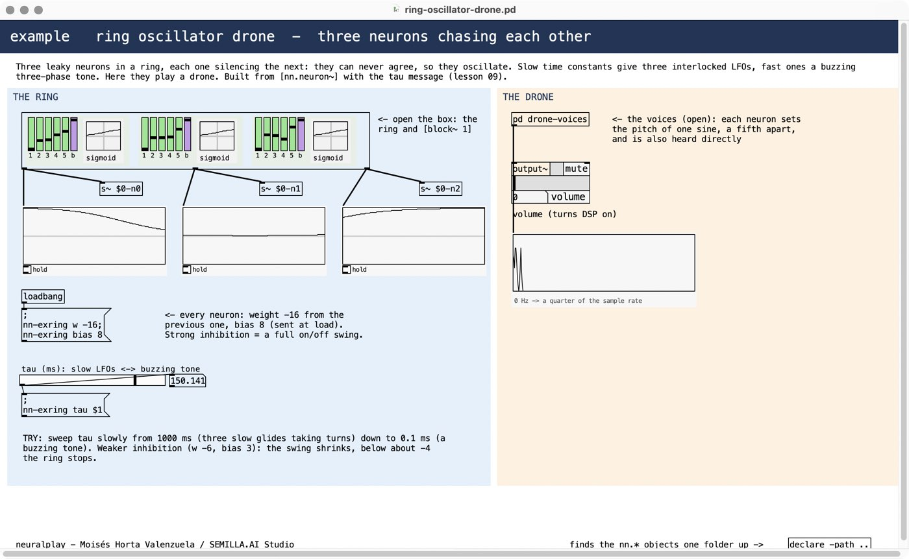
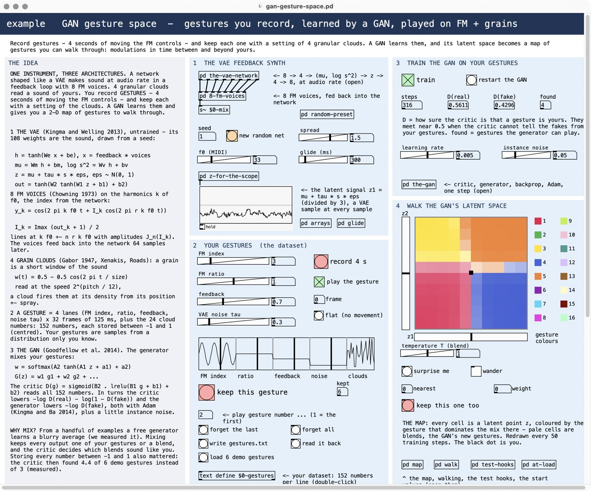
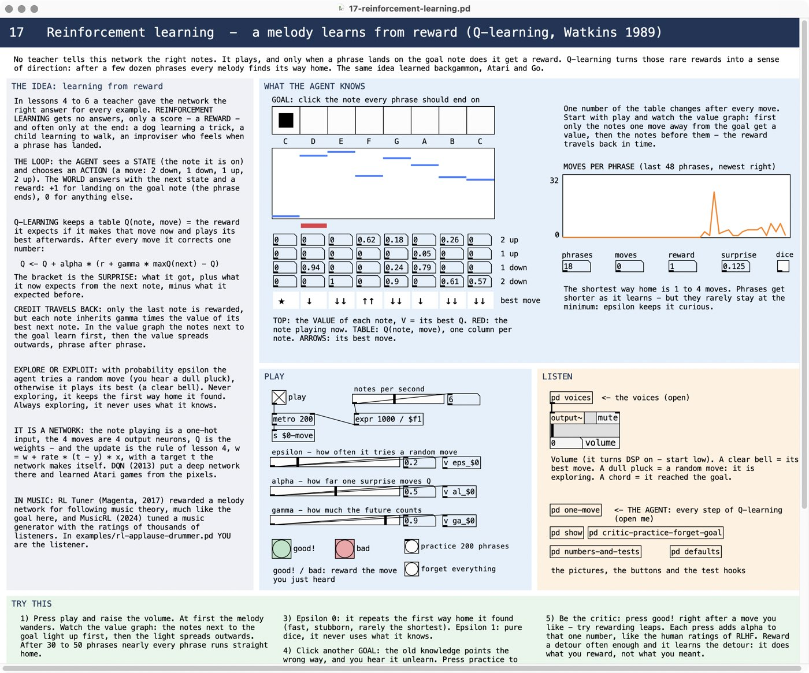
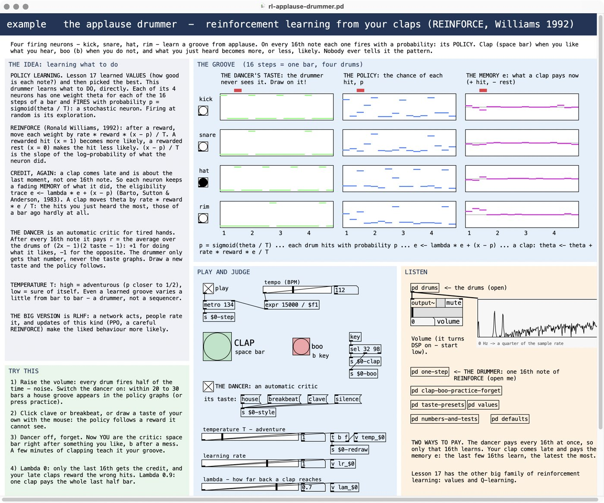

# neuralplay — a neural network playground for Pure Data

**by Moisés Horta Valenzuela / SEMILLA.AI Studio**

Build, hear and understand neural networks — from the 1943 logic neuron to VAEs,
GANs, transformers, diffusion and reinforcement learning — and use them to control synthesis
and feedback systems. Seventeen commented lessons plus a small library of neuron objects, written
for music technology students. Everything is **vanilla Pd (0.54 or newer)**, no externals.


## Getting started

1. Install with deken (*Help → Find externals*, search `neuralplay`), or copy this folder anywhere.
2. Open **`00-START-HERE.pd`** and click a lesson.
3. In every lesson raise the volume of `[output~]` (it also switches audio on — start low),
   read **THE IDEA**, play with **PLAY**, then follow **TRY THIS**. Every `[pd ...]` box is
   commented: open it to see how it works.

To use the objects in your own patches: `[declare -path neuralplay]`.

## The lessons

| # | lesson | the idea | what you hear |
|---|--------|----------|---------------|
| 01 | McCulloch–Pitts (1943) | a neuron as a logic gate | three rhythms in, one bell decides |
| 02 | Activation functions | the curve of a neuron is a waveshaper | saturation, folding, octave-up, your own drawn curve |
| 03 | The neuron | weights + sum + bias + curve, built twice | a non-linear mixer of a chord |
| 04 | Perceptron (1958 / 1969) | learning from examples; why XOR fails | bells, buzzes and thuds as it learns |
| 05 | Hidden layers | two borders solve XOR | XOR of two rhythms; sped up = 1-bit ring modulation |
| 06 | Backpropagation (1986) | gradient descent through layers | the answers turn into the rhythm 0 1 1 0, the error hiss fades |
| 07 | Hopfield (1982) | memory as an energy landscape | a corrupted groove heals itself |
| 08 | Networks as mappings | 2 knobs → 4 synth parameters | a random-network FM instrument |
| 09 | Recurrent neurons (CTRNN) | leaky neurons in a loop oscillate | from LFO to audio-rate tone |
| 10 | Spiking neurons | LIF (1907) and Izhikevich (2003) | spikes as rhythms and pitches, pinging filters |
| 11 | Autoencoders / VAE | a learned latent space | gliding between timbres, sampling variations |
| 12 | GAN | forger vs critic | the forger learns the teacher's melody style (left/right ear) |
| 13 | Attention | softmax lookup with a temperature | a query morphing between four sounds |
| 14 | Transformer induction head | in-context copying | the network continues your melody |
| 15 | Diffusion | denoising step by step | a noise cloud condenses into a chord |
| 16 | Capstone: feedback reservoir | a 27-neuron network with feedback drives a synth | the NeuralNetwork-VAE-Dense instrument, rebuilt |
| 17 | Reinforcement learning (1989) | learning from reward: Q-learning, explore or exploit, credit travels back in time | a wandering melody learns its way home to the goal note; you can reward it too |





## The library

| object | what it is |
|--------|-----------|
| `[nn.neuron~]` | one neuron at audio rate: 5 inputs, weights, bias, activation, optional leak (`tau`), repeatable random weights, net-wide messages (`[s nn-<net>]`) |
| `[nn.act~]` | 14 activation functions as waveshapers (linear, step, sign, sigmoid, tanh, relu, leaky, softsign, sin, gauss, elu, gelu, swish, hardclip) |
| `[nn.act]` | the same curves for numbers |
| `[nn.dense]` | a whole layer on arrays — runs trained weights (see lesson 11) |
| `[nn.softmax]` | scores → probabilities with a temperature |
| `[nn.izh~]` | Izhikevich spiking neuron with 7 presets, from rhythm to audio rate |
| `[nn.plot2d]` | decision map of a 2-input network |
| `[nn.scope~]`, `[nn.spectrum~]` | tiny oscilloscope and spectrum analyser |

Every object has a help patch (right-click → Help).

## Examples and exercises

| patch | what it is |
|-------|-----------|
| `examples/ring-oscillator-drone.pd` | three neurons in a ring, each silencing the next: interlocked LFOs or a buzzing three-phase tone |
| `examples/spiking-drum-machine.pd` | two Izhikevich neurons play kick and hi-hat — no sequencer, no clock |
| `examples/vae-feedback-gan-presets.pd` | the simpler version: the same GAN learns static presets of the VAE synth (your favourite sounds, saved in `favourites.txt`) |
| `examples/gan-gesture-space.pd` | three architectures in one instrument: record FM gestures (modulations in time) together with 4 granular clouds on your own sound, a GAN learns them, you walk its latent space |
| `examples/rl-applause-drummer.pd` | reinforcement learning from your claps: 4 firing neurons learn a groove (REINFORCE); clap with the space bar, or let an automatic dancer judge |
| `exercises/ex01-a-and-not-b.pd` | program one neuron to play A AND NOT B, then press CHECK |

The start page lists both folders by itself (the MORE panel): drop your own patches in and press *refresh*.



### Combining architectures: the GAN gesture space

`examples/gan-gesture-space.pd` chains three architectures and two synths into one instrument:

1. **A VAE-shaped network makes sound.** 8 inputs -> 4 tanh -> mean and log-variance (2) -> sampled
   z = mu + tau * sigma * eps -> 4 tanh -> 8 outputs at audio rate (one `[expr~]` per neuron). The outputs set
   the modulation index of 8 FM voices on the harmonics of f0, and the voices feed back into the inputs. Its 108
   weights come from a seed (LeCun normal).
2. **4 granular clouds read a sound of yours** ("open a sound...", or 4 s sampled from the FM synth, or the
   default bells). Each cloud has position, spray, grain size, density, pitch and level; 8 Hann-windowed grain
   voices per cloud.
3. **You record gestures:** press record and move the 4 FM controls (index, ratio, feedback, VAE noise) for
   4 s = 32 frames; the gesture loops, and you keep it together with the current cloud setting. A gesture is
   152 numbers (4 x 32 frames + 24 cloud numbers), each stored between -1 and 1.
4. **A GAN learns your gestures.** The generator turns a point z of a 2-D latent square into mixing weights
   (softmax) over your gestures, the critic reads all 152 numbers; Adam, the non-saturating GAN loss and
   instance noise. Walk the map: inside a colour you hear one of your gestures - FM modulation and clouds
   together - on the borders the GAN's blends. Keep a blend you like and retrain.

Why a *mixing* generator: from a handful of examples a free generator only learned a blurry average (measured
while designing this). Storing every number centred between -1 and 1 also mattered (the critic found 4.4 of 6
demo gestures instead of 3). The map shows which gestures the GAN found - missing ones = mode collapse, lesson 12.



The simpler `examples/vae-feedback-gan-presets.pd` uses the same GAN on static presets: keep the random VAE presets
you like ("keep this sound"), train, and walk a map of presets instead of gestures.

### Reinforcement learning: lesson 17 and the applause drummer

Reinforcement learning gets no right answers, only a reward - often only at the end. The two patches show
its two big families:

- **Lesson 17 learns values (Q-learning, Watkins 1989).** A melody walks on 8 notes; each move (2 down,
  1 down, 1 up, 2 up) is an action, and landing on the goal note pays +1. After every move one number of the
  table changes: Q <- Q + alpha * (r + gamma * maxQ(next) - Q). You watch the value spread backwards from the
  goal, hear random (exploring) moves as dull plucks, and can press *good!* / *bad* to reward moves yourself
  (human feedback, as in RLHF). The lesson also tells the history, from Thorndike's cats (1898) to the
  2024 Turing award for Barto and Sutton.
- **The applause drummer learns a policy (REINFORCE, Williams 1992).** Four Bernoulli-logistic neurons (kick,
  snare, hat, rim) fire with p = sigmoid(theta / T) on each 16th note. A clap pays a fading memory of what was
  just played (an eligibility trace, Barto, Sutton & Anderson 1983): theta += rate * reward * e / T. An automatic
  "dancer" can judge instead of you; its taste is a graph you draw, and the drummer never sees it.




## Make your own

Copy `templates/lesson-template.pd`, rename it and replace the texts in CAPITALS — it has the
layout, the credit line, `[declare -path ..]` and the naming conventions built in. An
exercise checks itself: `[r exNN-check]` runs the check and prints `exNN-solved: 1` or `0`,
`[r exNN-solution]` loads the answer (see `ex01`). The full guide, with the Pd pitfalls to
avoid, is `CONTRIBUTING.md` in the source repository.

## Train your own latent space

`python/train_vae.py` (numpy only, a few seconds) trains the VAE of lesson 11 on 8 timbres and
writes its weights to `lessons/data/vae/`. Change the timbres, run it, reopen the lesson: Pd
plays your latent space. It is the same split as RAVE and `[nn~]`: train elsewhere, play in Pd.

## Verified

Every patch was rendered headlessly and measured against independent Python references
(for example: the perceptron solves AND / OR / NAND at the same epochs as a Python
perceptron, the backprop lesson learns XOR at the same epoch as a numpy implementation, the
CTRNN oscillates at the simulated frequencies, the Pd VAE matches numpy to 0.002, the
diffusion voices land on chord tones). Examples and exercises are tested too: every
exercise must fail as shipped and pass with its solution. For the GAN gesture space the tests check the math itself:
the analytic gradients agree with finite differences, one training step in Pd equals the numpy step (gradients and
Adam moments within 4e-6), the latent signal has mean mu, standard deviation tau * sigma and kurtosis 3, a voice's
spectrum matches the Bessel amplitudes J_n(I) for the index the network gives, recorded frames and the interpolated
playback are exact, and a grain read from a test chirp sounds at the frequency its position and pitch predict, at
exactly its density. Lesson 17 and the applause drummer are replayed in numpy: every traced move (the world,
the epsilon-greedy choice, the update) and every 16th note and clap (the probabilities, the dancer's reward, the
weights and the memory) match to float precision, the learned values equal value iteration, and the drummer
ends up playing the dancer's taste in all 64 cells. The test tools (`dev/check.py`,
`dev/shoot.py`) live in the source repository next to this package and are not needed to use it.

## Publishing on deken (maintainers)

```sh
# with the deken tool installed (https://github.com/pure-data/deken)
deken package --version 0.1.0 neuralplay
deken upload neuralplay[v0.1.0].dek        # needs a puredata.info account
```

The package is pure Pd (no compiled externals), so one upload works on every platform.

## Credits and license

neuralplay © 2026 Moisés Horta Valenzuela / SEMILLA.AI Studio — BSD 3-Clause (see `LICENSE.txt`).
Lesson 16 is a rebuild of the original *NeuralNetwork-VAE-Dense* patch.
